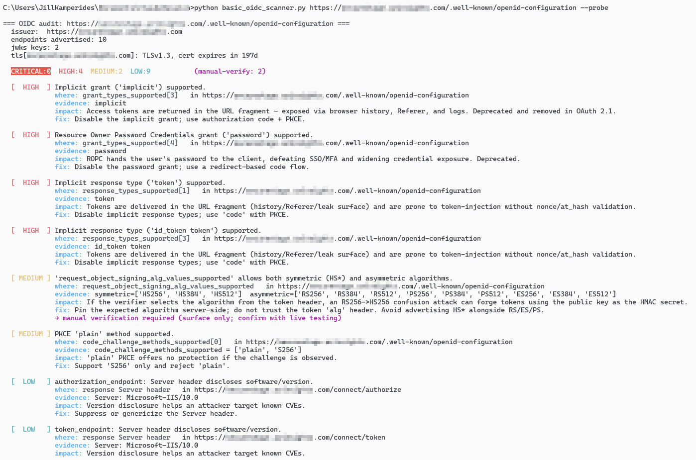
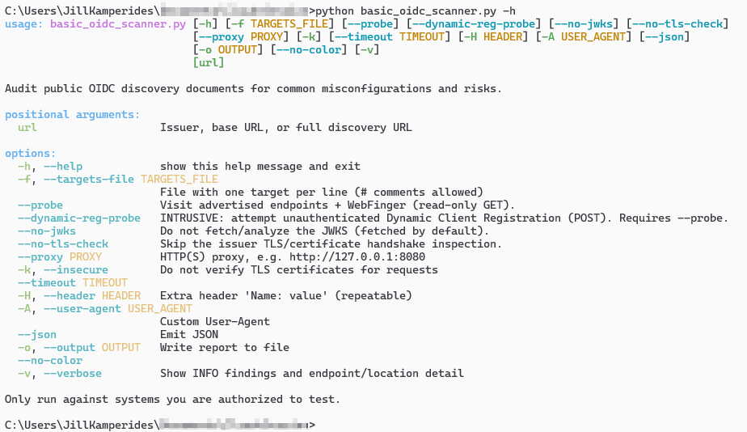

# basic-oidc-scanner

A lightweight, unauthenticated vulnerability scanner for public OpenID Connect (OIDC) / OAuth 2.0 providers.

Point it at an issuer and it checks what the provider already publishes to the world: the `.well-known/openid-configuration` discovery document, the JWKS, and the issuer's TLS. It then flags misconfigurations and weak keys.

No credentials, client registration, or login required. You don't need an account in the target environment or a working OIDC client. Everything it checks is something any anonymous user can already see.



## Use cases

Most OIDC testing tools assume you can sign in and watch real auth flows. This one is for:

- **Recon and external assessments.** Check an IdP before (or without) getting test accounts.
- **JWKS hygiene.** Public key sets are public by design. This tool looks for leaked private keys, broken or factorable keys, and mismatched certificates.
- **Bulk sweeps.** Scan a list of issuers and get JSON back, including which ones share signing keys.

Findings that only show a *potential* attack surface are tagged **manual verification required**.

## Install

```bash
git clone https://github.com/kampji/basic-oidc-scanner.git
cd basic-oidc-scanner
pip install requests cryptography   # cryptography is optional (enables x5c certificate checks)
```

## Usage

```bash
python3 basic_oidc_scanner.py https://login.example.com          # issuer, base URL, or full discovery URL
python3 basic_oidc_scanner.py https://login.example.com -v       # include INFO findings
python3 basic_oidc_scanner.py https://login.example.com --probe  # also GET advertised endpoints + WebFinger
python3 basic_oidc_scanner.py -f targets.txt --json -o out.json  # bulk scan to JSON
python3 basic_oidc_scanner.py https://login.example.com --proxy http://127.0.0.1:8080 -k   # through Burp
```



### Request tiers

Every tier is unauthenticated. You choose how much traffic hits the target.

| Mode | What it sends |
|---|---|
| **Default** | GET the discovery document and the JWKS, plus one TLS handshake. Nothing is written to the target. |
| `--probe` | Also GETs each advertised endpoint and `/.well-known/webfinger`. Read-only. |
| `--dynamic-reg-probe` | **Intrusive.** One POST to the registration endpoint to test anonymous client registration. Requires `--probe`. If it succeeds, ask the target to remove the `basic_oidc_scanner-probe` client. |

If `openid-configuration` isn't found, it falls back to the RFC 8414 `oauth-authorization-server` locations.

Other flags: `--no-jwks`, `--no-tls-check`, `--timeout`, `-H` (extra header), `-A` (User-Agent), `--no-color`, `--version`. Run `-h` for the full list.

**Exit code** is `1` if any CRITICAL/HIGH/MEDIUM finding is reported, so it drops into CI easily.

## What it checks

**Discovery document:**
- issuer problems (missing, not HTTPS, mismatched)
- non-HTTPS or off-domain endpoints
- `alg: none` and HS*/RS* algorithm-confusion surface
- missing or weak PKCE
- implicit and password grants
- `none` client auth
- `request_uri` SSRF surface
- open Dynamic Client Registration

**JWKS:**
- private or symmetric key material published in the JWKS
- weak RSA keys: under 2048 bits, bad exponents, moduli that factor (small primes or close primes), the ROCA fingerprint
- EC points that aren't on their curve
- `alg`/`use`/`key_ops` that don't match the key
- `x5c` certificates that are expired, SHA-1 signed, or carry a different key than the JWK
- `x5t` thumbprints that don't match the certificate
- missing, duplicate, or reused `kid`s
- in bulk scans, the **same key published by different issuers**

Key thumbprints (RFC 7638) are included in `--json` output.

**TLS:**
- an invalid, expired, or expiring certificate (checked even with `-k`)
- TLS older than 1.2

**With `--probe`:**
- cross-host redirects
- version-leaking `Server` headers
- missing HSTS
- wildcard CORS
- `userinfo` returning user claims anonymously
- WebFinger exposure

Each finding shows **where** it is (a JSON pointer), the **evidence**, the **impact**, and a **fix**.

## Disclaimer

Only scan systems you are authorized to test. The default mode is passive, but `--probe` and especially `--dynamic-reg-probe` interact with live endpoints.
